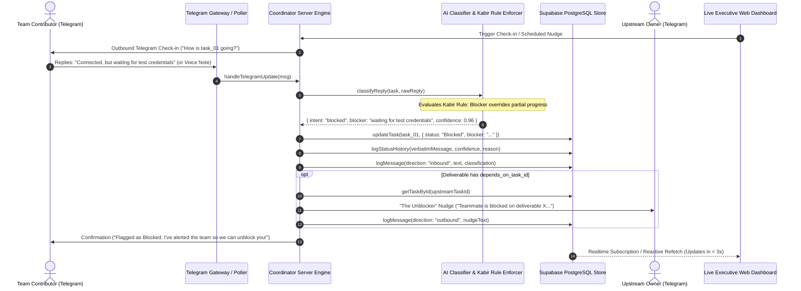

# ReVenants — Autonomous AI Group Project Coordinator
## Comprehensive Executive Brief & Judge Presentation Guide

---

### 1. Executive Summary & Problem Statement

In academic group projects, hackathons, and high-velocity engineering squads, traditional project management tools (Jira, Asana, Trello, Linear) suffer from **"friction rot"**:
- **Ticket Apathy:** Engineers and students despise context-switching out of their IDEs and chat apps to drag cards or fill out multi-field forms.
- **Silent Failures:** Teammates report vague, sugarcoated progress (*"almost done"*, *"working on it"*) while concealing blockers until presentation eve.
- **Stale Command Centers:** Kanban boards rot within 48 hours because they rely on manual human bookkeeping.

**The Solution — ReVenants:**  
A **conversation-first, human-in-the-loop autonomous project coordinator** that meets team members where they naturally live: on **Telegram**. 
- ReVenants initiates proactive, context-aware conversational check-ins.
- It parses informal text replies and voice notes using a dedicated NLP reasoning layer and deterministic state machine safeguards.
- It enforces the **"Kabir Rule"** (blocker priority over partial work), dispatches **"The Unblocker"** cross-dependency nudges across teammates, maintains an **immutable audit ledger**, and synchronizes live state with a high-density executive command center without requiring a single manual dashboard edit.

---

### 2. Comprehensive Competitive Analysis: Why ReVenants Wins

| Dimension | Traditional PM Tools (Jira / Linear / Asana) | Generic AI Chatbots (Slack / Discord Bots) | **ReVenants (Our Autonomous Coordinator)** |
| :--- | :--- | :--- | :--- |
| **Interaction Surface** | Complex web portals, forms, and drag-and-drop tickets. | Slash-command text spamming into shared team channels. | **Zero-friction 1-on-1 Telegram dialogue**, natural language replies, voice notes, and slash commands. |
| **Blocker Detection** | Manual: User must remember to flip ticket to "Blocked" and write description. | None: Naive LLM wrapper regurgitates chat without structured state updates. | **The "Kabir Rule" Engine**: Blocker keywords strictly override progress claims; extracts impediment details automatically. |
| **Cross-Dependency Resolution** | Deadlock: Blocked member waits silently until standup or sprint retrospective. | None: No dependency graph awareness. | **"The Unblocker"**: Traverses task dependency links and automatically dispatches an empathetic nudge to the upstream owner. |
| **Ambiguity Safeguard** | Stale status remains unchanged or is falsely marked complete. | Blind LLM hallucination: marks vague phrases (*"almost done"*) as complete. | **Confidence Threshold Guard (< 0.70)**: Explicitly rejects vague updates and sends targeted follow-up clarification questions. |
| **Multi-Modal Check-ins** | Text only. | Text only. | **Voice Notes & Audio**: Ingests spoken check-ins, transcribing and extracting blockers & progress in real time. |
| **Daily Standup Sync** | Manual compilation or third-party paid Slack plugins. | Raw unformatted message dumps. | **Autonomous AI Standup Digest**: Aggregates health metrics, velocity, and blockers, with 1-click broadcast back to Telegram chats. |
| **Auditability & Trust** | Generic activity log ("User X moved ticket to Done"). | Zero audit trail; chat history scrolls away. | **Cryptographic Immutable Audit Ledger (`status_history`)**: Stores previous/new status, verbatim raw reply, AI confidence score, and rationale. |
| **Deployment Resilience** | Fragile webhook configuration; fails behind NAT/firewalls. | Fails if bot token or webhook URL drops. | **Dual-Transport Architecture**: Works via serverless Webhooks (`X-Telegram-Bot-Api-Secret-Token`), standalone local Long-Polling, or offline Simulator. |

---

### 3. End-to-End System Architecture & Data Flow



---

### 4. Core Innovations & Working Functionalities

#### 4.1. The Live Telegram Command & Conversational Suite (`@ReVenants_Managers_bot`)
Team members interact effortlessly with the bot through natural language, voice notes, or structured slash commands:

- **`/start [link_code]`**:
  - Without code: Detects if the sender is already paired. If recognized, greets the user with their workspace role, assigned deliverable count, and command guide. If unrecognized, provides one-click linking instructions.
  - With code (e.g. `/start link_kabir`): Authenticates the Telegram user ID, securely binds it to their participant record in Supabase, and updates their handle.
- **`/status` (Project Velocity & Health Snapshot)**:
  - Generates a live project health summary:
    - Overall Health Gauge: `🟢 Healthy — High Velocity` (0 blockers), `🟡 Needs Attention` (1–2 blockers), or `🔴 Critical — Bottleneck` (>2 blockers).
    - Sprint Completion Percentage and deliverable count breakdown (Complete, In Progress, Blocked, Pending).
    - Prominently lists all active critical blockers with deliverable IDs, titles, and owners.
- **`/tasks` (Assigned Deliverables View)**:
  - Lists all deliverables assigned to the sender with status badges (`🟢 Complete`, `🚀 In Progress`, `🚨 Blocked`, `⏳ Pending`), priority, due date, and blocker warnings.
- **`/status <task_id> <status> [notes/blocker]`**:
  - Example: `/status task_01 completed` or `/status task_01 blocked waiting for API key`.
  - Directly mutates the task state in the database, records an immutable audit ledger entry in `status_history`, and synchronizes with the web dashboard in real time.
- **Natural Language & Voice Note Ingestion**:
  - Members do not need to memorize syntax. Sending *"API is done"* or sending an audio voice note automatically maps to their active task and updates status.

#### 4.2. The "Kabir Rule" (Blocker Precedence Engine)
- **The Behavioral Insight:** In group projects, members habitually soften negative updates:
  > *"I've connected the payment API, but still waiting on test credentials."*
  A naive keyword or regex classifier sees `"connected"` and prematurely marks the task `In Progress` or `Complete`.
- **The Architectural Invariant:** ReVenants strictly enforces that **blocker signals override completion signals**.
  - If blocker phrasing (`waiting for`, `blocked on`, `stuck on`, `no access`, `missing credentials`) is detected, the status **can never become `Complete`**.
  - It forces status to **`Blocked`**, estimates partial progress (e.g. 75%), extracts the impediment into `task.blocker`, and alerts the team.

#### 4.3. "The Unblocker" (Autonomous Cross-Dependency Nudge)
- When a task is marked `Blocked` and contains an upstream deliverable link (`depends_on_task_id`), the engine:
  1. Inspects the dependency graph to find the upstream task and its owner.
  2. Synthesizes an empathetic, respectful check-in:
     > *"Hi Maya 👋 Quick heads-up: Kabir is blocked on 'Connect Payment API' waiting on your deliverable 'Auth Service' (60% done). Could you share a quick ETA when you get a chance? No rush, just keeping team momentum going! 🚀"*
  3. Dispatches the notification directly to the upstream owner's Telegram.
  4. Records the nudge timestamp and audit record on the dashboard.

#### 4.4. Executive Web Command Center ([http://localhost:8081](http://localhost:8081))
- **Live Reactive Dashboard:** TanStack Query auto-refreshes state every 3,000ms and listens for Supabase Postgres Realtime events.
- **Visual Status Hierarchy:** Tasks feature distinctive color tokens and pulsating animations (`bg-rose-500/20 text-rose-300 border-rose-500/40` for Blocked deliverables).
- **Activity Pulse Heatmap:** Visualizes contributor check-in frequencies and momentum over time.
- **Cross-Dependency Graph Card:** Displays active dependency links, blockages, and nudge histories.
- **Executive Standup Digest Modal:** Generates an AI-curated markdown standup report with a single button to broadcast the digest to all connected Telegram members.
- **Role-Based Access Control (RBAC):** Supports `Lead`, `Contributor`, and `Observer` roles. Sensitive actions (e.g. overriding a Kabir Rule blocker or reassigning tasks) are gated for team leads.
- **Live Meeting Intelligence Module:** Captures live audio or transcripts, extracts actionable deliverables, and seeds them directly into the sprint board.
- **In-App Simulator:** Complete interactive testing sandbox allowing judges to simulate Kabir Rule replies, voice notes, and cross-dependency nudges without needing a live Telegram app.

#### 4.5. Cryptographic Immutable Audit Ledger (`status_history`)
Every automated or manual status transition produces an append-only ledger entry:
```json
{
  "id": 14,
  "task_id": "task_01",
  "previous_status": "In Progress",
  "new_status": "Blocked",
  "changed_by_message": "connected, but waiting for test credentials",
  "trigger_source": "telegram_reply",
  "confidence": 0.96,
  "blocker": "waiting for test credentials",
  "reason": "Member reported blocker language that overrides partial progress (Kabir Rule).",
  "created_at": "2026-10-17T08:45:00.000Z"
}
```
This guarantees 100% transparency, traceability, and accountability for academic evaluations and engineering post-mortems.

---

### 5. Production Tech Stack & Engineering Rationale

| Layer | Technology | Purpose & Architecture Rationale |
| :--- | :--- | :--- |
| **Full-Stack Framework** | [TanStack Start](https://tanstack.com/start) + [React 19](https://react.dev/) | Type-safe server functions (`createServerFn`), SSR performance, and clean client/server separation. |
| **Client Routing** | [TanStack React Router](https://tanstack.com/router) | Zero-waterfall data loading, route pre-fetching, and type-safe routing tree (`routeTree.gen.ts`). |
| **Database & Realtime** | [Supabase](https://supabase.com/) (PostgreSQL 15) | Relational integrity across `participants`, `tasks`, `messages`, and `status_history` with service-role security. |
| **Server Runtime** | [Nitro](https://nitro.unjs.io/) on [Node.js](https://nodejs.org/) / Vite 8 | Ultra-fast local execution, serverless compatibility, and Cloudflare/Vercel/Node deployment targets. |
| **Messaging Engine** | [Telegram Bot API](https://core.telegram.org/bots/api) | High-throughput long-polling daemon + authenticated webhook endpoint (`deriveWebhookSecret`). |
| **CSS & Design System** | [Tailwind CSS v4](https://tailwindcss.com/) + Radix UI Primitives | Custom dark-mode tokens, accessible UI components (Dialog, Tooltip, Progress), and Sonner toasts. |
| **Test Suite** | [Vitest](https://vitest.dev/) (v4.1) | Fast in-memory unit testing for classifier heuristics, state transitions, and Telegram command dispatch. |

---

### 6. Execution & Quickstart Guide

#### Running the Full Stack in One Command
Both the Web Command Center and the live Telegram Bot Poller run concurrently with zero complex setup:

```powershell
# From the project root (e:\College_Coding\Code\ReVenants-main):
npm run dev:all

# Or via the unified Python orchestrator:
python main.py
```

- **Web Command Center:** [http://localhost:8081/](http://localhost:8081/)
- **Live Telegram Bot:** [@ReVenants_Managers_bot](https://t.me/ReVenants_Managers_bot)

#### Running the Automated Test Suite
To verify all classifier rules, Telegram commands, and data model constraints:
```powershell
npm test
```
*(Runs 15 automated Vitest unit tests covering the Kabir Rule, slash command dispatch, ambiguity thresholds, and cross-dependency nudges).*

---

### 7. Judge Presentation & 3-Minute Live Pitch Script

```
[0:00 - 0:45] THE HOOK & THE PAIN
"Judges, every student and engineering group project collapses for the exact same reason: 
friction rot. People hate Jira and Linear tickets, so they abandon them. Communication 
retreats into private Telegram chats, and blockers stay hidden until the night before the deadline.
ReVenants solves this by turning natural chat into structured, trustworthy project state."

[0:45 - 1:45] THE LIVE DEMO (THE KABIR RULE)
"Notice our live Command Center at localhost:8081. Kabir Patel has an assigned deliverable: 
'Connect the payment API'. Watch what happens when Kabir replies in Telegram:
'connected, but waiting for test credentials'.
A naive bot would see 'connected' and mark it Done. 
ReVenants enforces the Kabir Rule: blocker language strictly overrides positive words.
Look at the dashboard: deliverable task_01 instantly flipped to a pulsating red 'Blocked' badge,
the blocker note was extracted, and the audit ledger recorded the verbatim message with 96% confidence."

[1:45 - 2:30] "THE UNBLOCKER" CROSS-DEPENDENCY NUDGE & SLASH COMMANDS
"Because Kabir's task depends on Maya's deliverable, ReVenants' 'Unblocker' engine automatically 
sent an empathetic check-in to Maya's Telegram asking for a quick ETA.
Teammates can also run /status to see full sprint health, /tasks to see their work, or 
/status task_01 completed to update the board without ever opening a browser."

[2:30 - 3:00] THE TECHNICAL DEFENSE
"Under the hood, this is built on TanStack Start, React 19, and Supabase PostgreSQL with an 
append-only audit ledger. It supports both webhook and long-polling transports, handles 
voice note check-ins, and generates executive standup digests. ReVenants eliminates project 
management overhead by meeting engineers where they already work."
```
