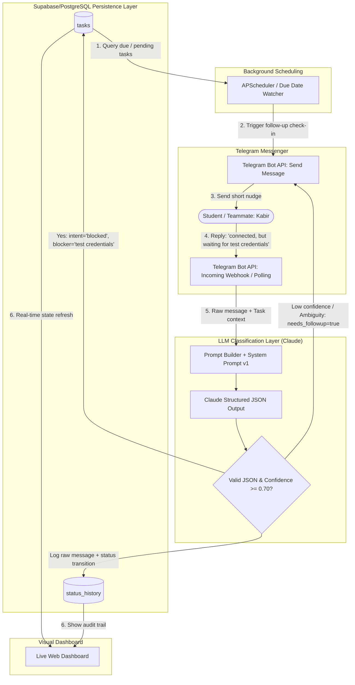

# 03. Architecture & Data Flow

The **AI Group Project Coordinator** is designed as a closed-loop reactive agent: it continuously monitors deadlines, reaches out to student assignees over Telegram, interprets incoming conversational updates using Claude, records audited transitions, and updates a live dashboard.

---

## 🔁 The Core Coordination Loop

Below is the end-to-end data flow representing how a scheduled check-in turns an informal student reply into an audited task update.

---

## 🧩 Architectural Components

| Component | Technology | Role & Responsibility |
|-----------|------------|-----------------------|
| **Messaging Gateway** | Telegram Bot API (`aiogram` / `python-telegram-bot`) | Handles two-way communication with Telegram. Listens for user replies (webhook or polling), manages sessions, and sends bot nudges via `ChannelAdapter`. |
| **Scheduler** | `APScheduler` (`AsyncIOScheduler`) | In-process cron and interval task runner that periodically scans Supabase for tasks nearing deadlines or requiring follow-ups. |
| **LLM Classification Engine** | Anthropic Claude API (`claude-haiku-5-5` / `claude-sonnet-5-5`) | Analyzes student replies with strict JSON constraints and tool use. Enforces the "Kabir Rule" prioritizing blockers over partial work. |
| **Data & Audit Store** | Supabase/PostgreSQL via the Supabase Python client | Hosted relational database holding `tasks`, `participants`, `messages`, and the immutable `status_history` audit trail. |
| **Web Dashboard** | Python `FastAPI` + Jinja2 / HTMX / Tailwind | Lightweight live dashboard rendering task statuses, owners, dependencies, and blocker flags with real-time HTMX auto-refresh. |

> [!NOTE]
> For the complete tech stack rationale, deployment configuration, container packaging, and alternatives considered, see [11_TECH_STACK_AND_DEPLOYMENT.md](file:///c:/Users/Admin/Pre%20Essential%20project%20documents/docs/11_TECH_STACK_AND_DEPLOYMENT.md).

---

## ⚖️ Key Technical Choices & Rationale

*(Summarized below. For our in-depth evaluation matrix including WhatsApp, Slack, Celery, and Next.js alternatives, see [11_TECH_STACK_AND_DEPLOYMENT.md](file:///c:/Users/Admin/Pre%20Essential%20project%20documents/docs/11_TECH_STACK_AND_DEPLOYMENT.md#10-alternatives-we-considered).)*

### 1. Why Telegram Bot API instead of Slack or Discord?
- **Student Reality**: Most college project groups default to mobile messaging apps (Telegram, WhatsApp). Telegram provides the cleanest, most reliable bot API with zero paywalls, instant webhooks, and full mobile push notifications.
- **Low Friction**: Teammates do not need to install enterprise workspace apps or configure OAuth.

### 2. Why Claude with Structured JSON Output?
- **Instruction Following on Nuanced Logic**: Claude excels at subtle semantic distinctions—specifically detecting that *"connected, but waiting for test credentials"* represents a blocker rather than a success.
- **Zero Hallucination Formatting**: When provided with a schema, Claude adheres strictly to JSON keys without injecting commentary.

### 3. Why Supabase for Data & Audit Trails?
- **Shared hosted state**: The dashboard and background worker can access the same project data without depending on a local container volume.
- **PostgreSQL foundation**: The relational schema keeps task ownership, dependencies, messages, and audit history queryable as the project grows.
- **Security boundary**: Supabase Row Level Security can be enabled before browser-facing access is added.

### 4. Why APScheduler?
- **Python-Native Background Jobs**: Runs in-process with FastAPI, avoiding the need for heavy Celery/Redis infrastructure while supporting cron, interval, and date-based triggers.

