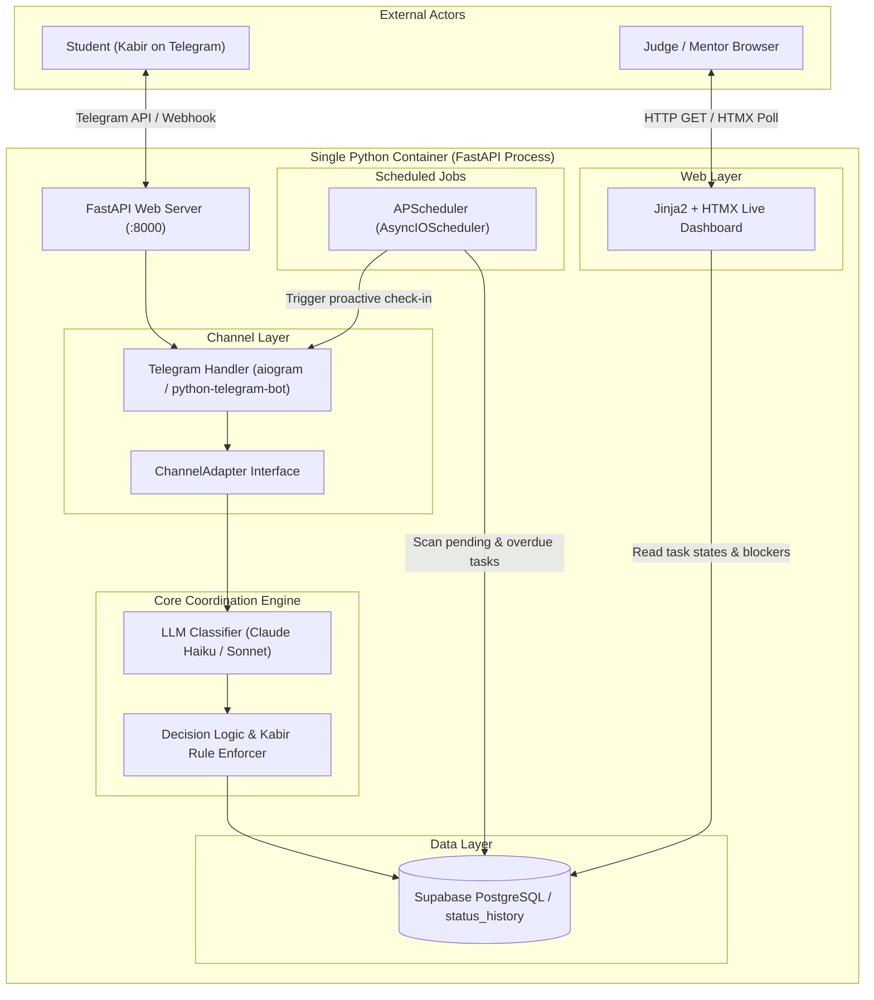

# 11. Tech Stack & Deployment Overview

---

## 1. Overview

The **AI Group Project Coordinator** is an autonomous assistant designed to keep student teams on track by proactively checking in on pending deliverables over Telegram. It parses informal conversational replies using Claude (differentiating true progress from subtle blockers), records auditable state transitions, and mirrors live project health onto a real-time web dashboard. A canonical example is teammate Kabir replying *"connected, but waiting for test credentials"*: rather than marking the task complete, the system flags it as **`Blocked`** and logs the blocker details. Architecturally, we package the coordinator as **a single Python service inside a single Docker container**—minimizing moving parts and eliminating external message brokers to guarantee rock-solid reliability during live judging.

For deep system sequence diagrams and relational schemas, see [03_ARCHITECTURE.md](file:///c:/Users/Admin/Pre%20Essential%20project%20documents/docs/03_ARCHITECTURE.md) and [04_DATA_MODEL.md](file:///c:/Users/Admin/Pre%20Essential%20project%20documents/docs/04_DATA_MODEL.md).

---

## 2. Tech Stack Table

| Layer | Choice | Why |
|---|---|---|
| **Language** | Python 3.12 | Modern type hinting, native async performance, robust ecosystem for LLM orchestration and web frameworks. |
| **Backend / API** | FastAPI | High-performance asynchronous execution, automated OpenAPI docs at `/docs`, native Pydantic request/response validation. |
| **Messaging** | Telegram Bot API (`aiogram` / `python-telegram-bot`) | Battle-tested async Telegram wrappers supporting seamless switching between long-polling and webhooks. |
| **LLM Classification** | Anthropic Claude API (`claude-haiku-5-5` & `claude-sonnet-5-5`) | `claude-haiku-5-5` delivers fast, low-cost classification; `claude-sonnet-5-5` acts as fallback for complex, ambiguous, or multi-task replies. |
| **Structured Output** | Tool use / JSON schema + Pydantic | Guarantees strict type conformity without free-form hallucination; backed by automated retry and a safe fallback parser. |
| **Database** | Supabase PostgreSQL via the Supabase Python client | Hosted relational persistence with shared access for the worker and dashboard; schema and audit tables are defined in `supabase_schema.sql`. |
| **Scheduler** | APScheduler (`AsyncIOScheduler`) | In-process cron and interval task runner that integrates cleanly into FastAPI's async event loop without Redis/Celery. |
| **Dashboard** | Jinja2 + HTMX + Tailwind CSS | Server-rendered live UI served directly by FastAPI; HTMX provides dynamic polling/swapping without frontend build pipelines. |
| **Optional Visibility** | Google Sheets sync via `gspread` | Optional background exporter mirroring task rows to a spreadsheet for non-technical mentors and advisors. |
| **Packaging** | Docker | Single container containing code and static templates; persistent project data is hosted in Supabase. |
| **Hosting** | Railway or Fly.io | Always-on container hosting with persistent volume support, zero sleep delays, and automatic HTTPS webhooks. |
| **Testing** | pytest + custom evaluation runner | Unit tests for state transitions and an automated 16-case benchmark evaluating LLM prompt accuracy against regression. |
| **Logging & Audit** | Structlog / stdlib logging + DB audit table | Structured JSON console logging paired with an immutable `status_history` PostgreSQL table capturing raw messages. |
| **Secrets Management** | Environment variables (`.env`) | Strictly injected via environment variables; `.env.example` committed with placeholders, actual `.env` git-ignored. |

---

## 3. Architecture Summary

The coordinator operates as a unified asynchronous service running FastAPI. Incoming Telegram messages are received via webhook (or polling in development), routed through an extensible adapter, classified by Claude, processed by the business rules engine, and committed to Supabase. Simultaneously, APScheduler triggers proactive nudges and the dashboard reads task health.



### Extensible Messaging via `ChannelAdapter`
To prevent vendor lock-in, all messaging interactions pass through a lightweight `ChannelAdapter` protocol:
```python
# Conceptual interface: src/channels/base.py
class ChannelAdapter(Protocol):
    async def send_message(self, recipient_id: str, text: str) -> bool: ...
    async def parse_incoming(self, raw_payload: dict) -> IncomingMessage: ...
```
This isolates Telegram-specific payload details from core logic, enabling future integrations (Slack, WhatsApp Cloud API) without rewriting the coordinator.

---

## 4. Telegram: Polling vs. Webhook

The system supports two ingestion modes controlled by the `MODE` environment variable:

```mermaid
flowchart LR
    subgraph Dev["Development & Demo Fallback: MODE=polling"]
        BotPoll["Coordinator Bot"] -->|GET getUpdates (Long-Poll)| TGServer1["Telegram Servers"]
    end

    subgraph Prod["Production Deployment: MODE=webhook"]
        TGServer2["Telegram Servers"] -->|POST https://app.railway.app/webhook| FastAPIPort["FastAPI Endpoint"]
    end
```

| Ingestion Mode | Recommended Environment | Advantages | Trade-offs |
|---|---|---|---|
| **`MODE=polling`** | Local development, hackathon backup | Zero public URL or tunnel required; immune to DNS/SSL routing hiccups; ideal demo safety net. | Consumes continuous network polling threads; slightly higher latency (~300ms). |
| **`MODE=webhook`** | Production (Railway, Fly.io) | Immediate event-driven push from Telegram servers; lower server idle overhead; standard HTTPS design. | Requires public HTTPS endpoint with valid SSL; fails if host domain expires or sleeps. |

*Implementation strategy*: When the service boots, `src/main.py` checks `MODE`. If set to `polling`, it deletes any active webhook and starts polling in a background task; if `webhook`, it registers the public callback URL with Telegram's `setWebhook` API.

---

## 5. How the LLM is Used

Claude is not used as a conversational chatbot; it is treated as a deterministic, structured classification pipeline with five strict operational safeguards:

1. **Context-Aware Classification**: The model never analyzes a user reply in isolation. The prompt includes the user's open tasks, deliverables, deadlines, and the last two check-in messages so ambiguous replies like *"done with the first half"* resolve against the correct task ID.
2. **Strict Structured Schema**: Outputs are strictly constrained via Claude tool use / JSON schema returning:
   ```json
   {
     "updates": [
       {
         "task_id": 4,
         "intent": "blocked",
         "progress_percent": 60,
         "blocker": "waiting for test credentials",
         "needs_followup": false,
         "confidence": 0.94,
         "clarifying_question": null
       }
     ]
   }
   ```
   Multi-task updates (e.g., *"finished auth, but database migration failed"*) return an array of typed objects.
3. **Deterministic Rule Layer (The Kabir Rule)**: Model predictions are validated by application rules. **If `blocker` is non-empty, the task status can NEVER transition to `Complete`**, regardless of whether the model misclassified the intent or progress percentage.
4. **Confidence Gating**: If Claude reports an extraction confidence below `0.70` (or marks `needs_followup: true`), the state machine refrains from modifying task records and instead routes the generated `clarifying_question` back to the student.
5. **Idempotency & Deduplication**: Every incoming Telegram update includes a monotonic `update_id`. The handler records processed IDs in Supabase, discarding duplicates caused by network retries.

---

## 6. Why Telegram Over WhatsApp

A deliberate design decision was made to build on Telegram for the hackathon prototype rather than WhatsApp:

| Dimension | Telegram Bot API | WhatsApp Business Cloud API |
|---|---|---|
| **Setup Time** | **< 2 minutes** via [@BotFather](https://t.me/BotFather) | Several days (Meta Business Manager verification, app approval) |
| **Official Access** | **Free, open, immediate** API keys | Enterprise verification, credit card requirement |
| **Messaging Rules** | **Unrestricted bot outreach** once user starts bot | **Strict 24-hour service window**; outbound nudges require pre-approved HSM templates |
| **Webhook Requirements** | Optional (supports polling or webhooks) | Mandatory HTTPS webhook with signature verification |
| **Operating Cost** | **100% Free** | Per-conversation charges after initial free tier |
| **Unofficial Libraries** | Unnecessary (official API is open) | High risk of permanent phone number bans with unofficial wrappers (e.g. Baileys) |

### The Strategic Decision
**Telegram is our primary channel today.** It gives 100% reliable messaging without ban risks or meta approval hurdles. WhatsApp support is slated on our [10_ROADMAP.md](file:///c:/Users/Admin/Pre%20Essential%20project%20documents/docs/10_ROADMAP.md) using the official WhatsApp Cloud API and pre-approved check-in templates, ensuring it never jeopardizes the demo critical path.

---

## 7. Deployment Plan

The coordinator is packaged for rapid container deployment:

### Containerization Strategy
- **`Dockerfile`**: Lightweight single-stage build based on `python:3.12-slim`. Installs dependencies, sets non-root user permissions, and exposes port `8000`.
- **`docker-compose.yml`**: Runs the application while Supabase stores database changes outside the container.

```bash
# Local development launch
docker compose up --build
```

### Cloud Hosting: Railway / Fly.io
1. Target an always-on deployment platform (Railway or Fly.io) provisioned with 512MB RAM.
2. Configure `SUPABASE_URL` and `SUPABASE_KEY`; no database volume is required in the application container.
3. Configure environment variables (`TELEGRAM_BOT_TOKEN`, `ANTHROPIC_API_KEY`, `MODE=webhook`, `WEBHOOK_URL`).
4. Execute pre-flight verification: test Telegram bot nudges and live dashboard auto-refresh from an external network (mobile data).

> [!WARNING]
> **Free Tier Sleep Hazard**: Free hosting plans that sleep on inactivity (e.g., Render free tier) are strictly avoided. When a sleeping container spins down, background APScheduler check-ins halt and incoming student replies suffer a 30-50 second cold-start delay—ruining live demos.

### Offline / Local Demo Fallback
If venue Wi-Fi or cloud hosting experiences an outage during judging:
1. Boot the service locally on a laptop: `MODE=polling uvicorn src.main:app --port 8000`.
2. Connect laptop to mobile phone 4G/5G hotspot.
3. Long-polling connects directly to Telegram servers with zero firewall or port forwarding issues.
4. Judges view the dashboard locally at `http://localhost:8000`.

---

## 8. Planned Folder Layout

The repository is structured to cleanly separate concerns across communication, intelligence, storage, and presentation:

```
ai-group-project-coordinator/
├── Dockerfile                  # Single container specification
├── docker-compose.yml          # Local container runner
├── requirements.txt            # Python dependencies (FastAPI, Claude, APScheduler, etc.)
├── .env.example                # Sample environment variables template
├── README.md                   # Project overview and entry point
├── docs/                       # Specifications, architecture, and evaluations
│   ├── 03_ARCHITECTURE.md
│   └── 11_TECH_STACK_AND_DEPLOYMENT.md
├── prompts/                    # Versioned prompts and test suites
│   ├── classifier_system_prompt_v1.md
│   └── TEST_CASES.md
├── src/
│   ├── __init__.py
│   ├── main.py                 # FastAPI application factory and lifespan hooks
│   ├── config.py               # Pydantic Settings reading environment variables
│   ├── channels/               # Messaging gateway implementations
│   │   ├── __init__.py
│   │   ├── base.py             # ChannelAdapter protocol definition
│   │   └── telegram.py         # Telegram bot handler (aiogram / python-telegram-bot)
│   ├── llm/                    # Language model extraction pipeline
│   │   ├── __init__.py
│   │   ├── client.py           # Anthropic Claude API client
│   │   ├── schemas.py          # Pydantic structured output models
│   │   └── prompts.py          # System prompt loaders
│   ├── services/               # Core business and coordination rules
│   │   ├── __init__.py
│   │   ├── coordinator.py      # Main message processing orchestration
│   │   └── state_machine.py    # Status transition rules (enforcing Kabir Rule)
│   ├── db/                     # Data persistence and migrations
│   │   ├── __init__.py
│   │   ├── database.py         # SQLAlchemy engine and session factory
│   │   └── models.py           # Task, Participant, Message, StatusHistory models
│   ├── scheduler/              # Proactive background jobs
│   │   ├── __init__.py
│   │   └── jobs.py             # APScheduler due-date watchers and reminders
│   └── web/                    # Presentation and live dashboard
│       ├── __init__.py
│       ├── router.py           # FastAPI routes serving dashboard endpoints
│       ├── templates/          # Jinja2 HTML templates
│       └── static/             # CSS and minimal JavaScript
└── tests/
    ├── __init__.py
    ├── test_classifier.py      # LLM classification tests against benchmark
    ├── test_state_machine.py   # State transition and Kabir Rule unit tests
    └── run_eval.py             # CLI eval runner reporting prompt accuracy
```

---

## 9. Build Timeline

We divide development into 7 structured phases with strict feature freezes prior to live rehearsals:

| Phase | Estimated Hours | Focus & Deliverables | Milestone Gate |
|---|---|---|---|
| **Phase 1: Skeleton & First Message** | 3 – 5 hrs | FastAPI app scaffold, Telegram bot configuration, send outbound test message via script. | Bot successfully sends and receives a raw message on Telegram. |
| **Phase 2: Replies & Classification** | 4 – 6 hrs | Integrate Anthropic SDK, Claude tool-use JSON schema, Pydantic parsing, and prompt loading. | 16-case benchmark in `prompts/TEST_CASES.md` runs with >= 90% pass rate. |
| **Phase 3: Dashboard & Kabir Case End-to-End** | 4 – 6 hrs | Supabase models, state machine, FastAPI Jinja2 + HTMX live dashboard. | End-to-end flow: Kabir reply *"connected, but waiting for test credentials"* turns dashboard badge `Blocked`. |
| **Phase 4: Scheduler & Clarifications** | 3 – 5 hrs | APScheduler cron jobs, due date watcher, confidence gating (< 0.70 prompts clarifying question). | Bot automatically initiates follow-up nudges for tasks nearing deadlines. |
| **Phase 5: Reports, Eval Script, Optional Sheets** | 3 – 4 hrs | Daily summary digest generator, CLI eval runner (`run_eval.py`), optional `gspread` exporter. | Full evaluation suite executes and prints formatted accuracy report. |
| **Phase 6: Dockerize & Cloud Deploy** | 2 – 4 hrs | `Dockerfile`, `docker-compose.yml`, Railway / Fly.io volume provisioning, webhook configuration. | Webhook responds under public domain; database survives container restart. |
| **Phase 7: Docs, Evidence & Rehearsal** | 3 – 5 hrs | **FEATURE FREEZE**. Capture screenshot evidence, record demo video, dry-run 5-minute judge pitch. | Seamless 5-minute rehearsal completed without runtime code modifications. |

---

## 10. Alternatives We Considered

| Option | Verdict | Rationale & Trade-offs |
|---|---|---|
| **Slack as primary channel** | **Rejected** | Requires enterprise workspace creation, OAuth permissions, and invites. Student teams overwhelmingly communicate on mobile chat apps, not Slack. |
| **Node.js + Next.js stack** | **Rejected** | Introduces multi-language complexity. Since Python is required for LLM prompt evaluation and AI libraries, FastAPI + HTMX keeps the entire codebase in unified Python. |
| **Streamlit for dashboard** | **Rejected** | Streamlit's execution model re-runs entire scripts on state change, causing race conditions with async Telegram webhooks and APScheduler workers. |
| **LangChain / Heavy Agent Frameworks** | **Rejected** | Adds heavy abstraction overhead, brittle prompt wrappers, and difficult debugging. Direct Anthropic SDK with JSON schema tool use is transparent, lightweight, and deterministic. |
| **Celery + Redis for scheduling** | **Rejected** | Demands running and monitoring separate Redis and worker containers. APScheduler runs in-process inside FastAPI, eliminating external dependencies. |
| **Firebase** | **Rejected** | Supabase provides the PostgreSQL relational model and SQL schema needed by ReVenants; a document-first database would add unnecessary modeling changes. |

---

## 11. Environment Variables

The table below lists all required and optional configuration keys matching `.env.example`:

| Variable | Required | Default | Description / Purpose |
|---|---|---|---|
| `TELEGRAM_BOT_TOKEN` | **Yes** | *None* | Authentication token provided by [@BotFather](https://t.me/BotFather) for Telegram Bot API access. |
| `ANTHROPIC_API_KEY` | **Yes** | *None* | Anthropic API key used to query Claude 3.5 Sonnet and Haiku models. |
| `SUPABASE_URL` | **Yes** | *None* | URL of the Supabase project. |
| `SUPABASE_KEY` | **Yes** | *None* | Server-side key used by the application to access Supabase. Keep it out of source control. |
| `MODE` | No | `polling` | Telegram connection mode: `polling` for local dev / offline demo, `webhook` for production. |
| `WEBHOOK_URL` | Conditional | *None* | Public HTTPS callback URL registered with Telegram (required if `MODE=webhook`). |
| `WEBHOOK_SECRET` | No | *None* | Secret token passed in Telegram webhook headers to verify payload authenticity. |
| `LOG_LEVEL` | No | `INFO` | Console log verbosity (`DEBUG`, `INFO`, `WARNING`, `ERROR`). |
| `DASHBOARD_PORT` | No | `8000` | Port on which the FastAPI dashboard and webhook receiver listen. |

*(Note: Real keys and credentials are never checked into version control.)*

---

## 12. Status of Each Component

To maintain complete transparency for judges and contributors, this table tracks the actual implementation state of every architectural component:

| Component | Target File | Current Status | Notes |
|---|---|---|---|
| **Telegram Messaging Gateway** | `src/channels/telegram.py` | `TODO / Not yet built` | Bot token verified; handler code not yet written. |
| **LLM Classification Pipeline** | `src/llm/client.py`, `schemas.py` | `TODO / Not yet built` | Prompts drafted in `prompts/`; Python client not yet built. |
| **Database & Supabase Connection** | `src/db/database.py`, `supabase_schema.sql` | **Connection/schema added; integration pending** | Supabase client factory and PostgreSQL schema are present, but the rest of the application modules are not in this checkout. |
| **State Machine & Kabir Rule** | `src/services/state_machine.py` | `TODO / Not yet built` | Specification defined in `docs/05_REPLY_UNDERSTANDING.md`. |
| **In-Process Scheduler** | `src/scheduler/jobs.py` | `TODO / Not yet built` | APScheduler integration pending Phase 4. |
| **FastAPI Dashboard & HTMX** | `src/web/router.py`, `templates/` | `TODO / Not yet built` | UI mockup designed; template implementation pending Phase 3. |
| **Docker Packaging** | `Dockerfile`, `docker-compose.yml` | `TODO / Not yet built` | Docker configuration scheduled for Phase 6. |
| **Automated Benchmark Runner** | `tests/run_eval.py` | `TODO / Not yet built` | Benchmark test cases drafted in `prompts/TEST_CASES.md`. |
